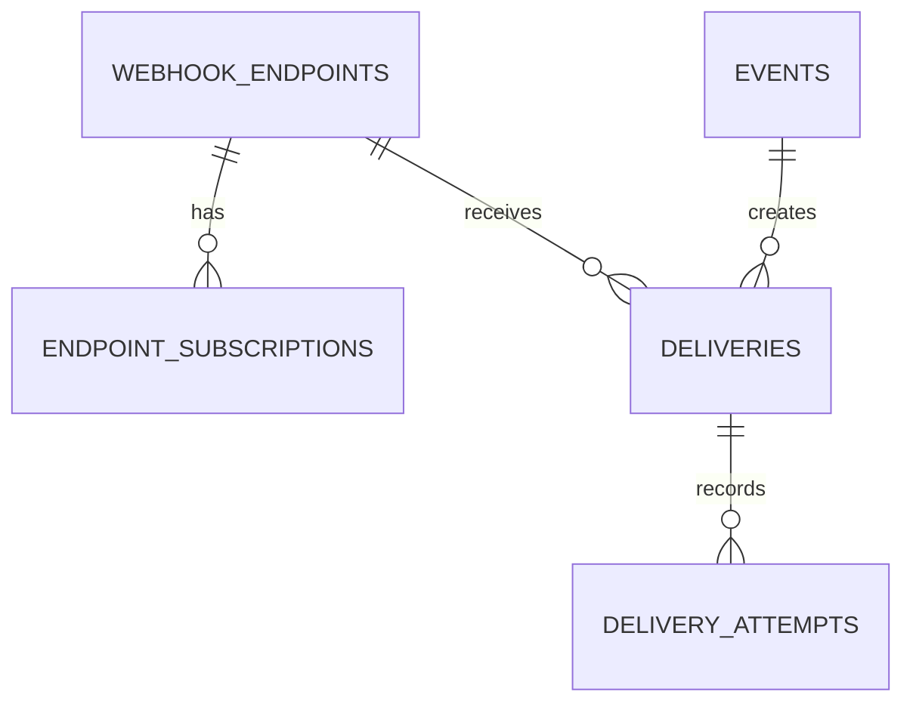
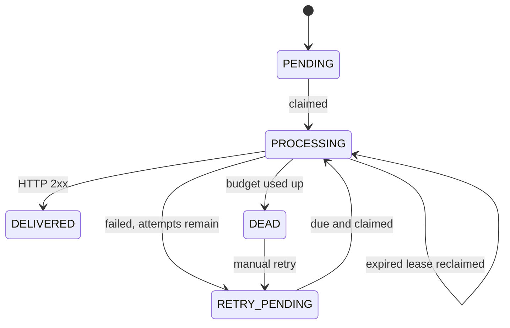

# SignalDock architecture

One React client, one Spring Boot process and one PostgreSQL database. The dashboard polls a snapshot every four seconds.

## Backend packages

| Package | Responsibility |
|---|---|
| `security` | Checks `X-API-Key` against the configured key (constant-time) |
| `endpoint` | Registers and pauses receivers, validates URLs, generates signing secrets |
| `subscription` | Event-pattern routes: exact, `order.*` or `*` |
| `event` | Idempotent ingestion; one delivery per matched endpoint |
| `delivery` | Queue claim, signing, HTTP sending, attempts, backoff, manual retry |
| `exception` | One JSON error shape for every failure |
| `config` | Typed settings, OpenAPI, pagination |
| `demo` | Seed data plus a 202 receiver and a 503 receiver (`demo` profile only) |

## Data model

| Constraint or index | Why |
|---|---|
| Unique `events.idempotency_key` | Concurrent retries of one request create one event |
| Unique `deliveries (event_id, endpoint_id)` | Two matching patterns can't create duplicate work for one receiver |
| Unique `endpoint_subscriptions (endpoint_id, event_pattern)` | No duplicate routes; patterns stored lower-case |
| Unique `delivery_attempts (delivery_id, attempt_number)` | Ordered, auditable attempt history |
| Index `deliveries (status, next_retry_at)` | The worker's claim query |
| Index `created_at DESC` on events and deliveries | Newest-first lists |

Endpoints are paused, never deleted, so old deliveries keep a valid reference. `signing_secret` is stored in plain text because the worker needs the original to sign every attempt.

## Event ingestion

`EventService.ingest` runs in one transaction:

1. `INSERT … ON CONFLICT (idempotency_key) DO NOTHING`. If nothing was inserted, return the existing event with `duplicate: true` (HTTP 200).
2. Otherwise, find active subscriptions on active endpoints whose pattern matches, and save one `PENDING` delivery per endpoint.
3. Commit, so the event and its deliveries appear together or not at all (HTTP 201).

## Delivery worker

Each poll goes through three steps:

1. **Claim (transaction 1):** select due `PENDING` and `RETRY_PENDING` rows, plus `PROCESSING` rows with an expired lease, using `FOR UPDATE SKIP LOCKED`. Mark them `PROCESSING` with a new lease.
2. **Send (no transaction):** sign and POST with connect and read timeouts. Redirects aren't followed.
3. **Record (transaction 2):** re-lock the row, skip it if it's no longer `PROCESSING`, save the attempt, and move the delivery to `DELIVERED`, `RETRY_PENDING` or `DEAD`.

The worker calls these through a separate bean so Spring's `@Transactional` proxy applies. If the process dies mid-way, the lease expires and the row is reclaimed. That's why delivery is at least once.

Backoff after attempt `n` is `min(baseDelay × 2^(n-1), maxDelay)`. A manual retry keeps old attempts and adds the endpoint's `maxAttempts` to the budget.

## Signatures

Each request carries `X-SignalDock-Timestamp`, `X-SignalDock-Event-Id`, `X-SignalDock-Event-Type`, `X-SignalDock-Delivery-Id` and `X-SignalDock-Signature`. The signature is `sha256=` plus the hex HMAC-SHA256 of `timestamp + "." + rawBody`. Receivers should recompute it over the raw body, compare in constant time, and reject old timestamps.

## Security

- All `/api/v1/**` routes need `X-API-Key`. Health, Swagger and the demo receivers are public.
- An endpoint's signing secret is shown once, at creation; later reads show only a hint.
- Endpoint URLs must be `http` or `https`, have a host and carry no credentials. There's no SSRF protection yet (see README).
