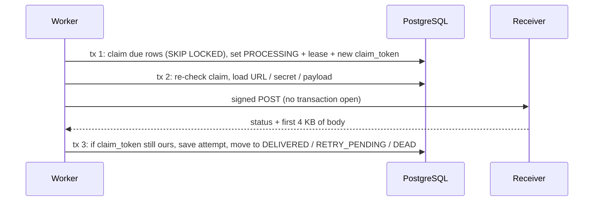

# SignalDock Design Decisions

This document explains *why* SignalDock is built the way it is: the choices, the alternatives that were rejected, and what would break first under more load. [`ARCHITECTURE.md`](ARCHITECTURE.md) describes *what* the parts are.

## Goals and non-goals

**Goals**

- Never lose an accepted event, even if the process crashes at the worst moment.
- One slow, broken or hostile receiver must not hurt delivery to anyone else.
- Every attempt is visible: status code, latency, error, response snippet.
- Small enough to run with one `docker compose up`.

**Non-goals (on purpose)**

- Exactly-once delivery. It is not achievable over plain HTTP; see "Delivery guarantee".
- Multi-tenancy, user accounts, billing.
- Horizontal scale beyond a few application instances sharing one database.

## 1. PostgreSQL is the queue (not Kafka or RabbitMQ)

When an event arrives, the event row and one delivery row per matched endpoint are written in **one transaction**. Either all of them exist or none do.

With a separate broker you write to the database and then publish to the broker. If the process dies between the two, the event is saved but the message is lost (or the reverse). Fixing that needs an outbox table plus a relay, which is a queue in Postgres anyway, plus a second system to run.

Postgres gives everything a delivery queue needs here:

- `FOR UPDATE SKIP LOCKED`: many workers can take jobs from the same table without blocking each other or taking the same row.
- Row leases (`lease_until`): if a worker dies, its jobs become claimable again.
- Plain SQL for the dashboard: "show me every DEAD delivery for this endpoint" is one query.

**Trade-off:** a Postgres queue tops out far below Kafka. For webhook traffic (thousands per second at most for a product this size) that is fine. See section 10 for what breaks first.

## 2. One delivery = claim, send, record

The HTTP call happens with **no transaction open**. A receiver that takes 6 seconds to time out never holds a row lock or a pooled database connection for those 6 seconds.

## 3. Sends run in parallel on virtual threads

**Problem (before):** the worker sent a batch of 20 deliveries one after another on Spring's single scheduler thread. Each send could take up to 6 s (2 s connect + 4 s read), so one dead receiver with a backlog made *everyone* wait, and throughput dropped to roughly one delivery every 6 seconds.

**Now:** every delivery in a batch is sent on its own virtual thread (Java 21). The poll waits until the whole batch is done before the next poll. Batch time is now about *the slowest single send* (bounded at connect + read timeout), not *the sum of all sends*.

**Why virtual threads and not a thread pool?** Each send spends nearly all its time waiting on the network. Virtual threads make "one thread per request" cheap, so there is no pool size to tune and the code stays plain blocking code that is easy to read and debug.

**Why wait for the batch before polling again?** It keeps the number of in-flight requests bounded by `batch-size` and makes the lease maths simple (section 5).

`DeliveryQueueIntegrationTest.slowReceiversAreSentInParallelInsteadOfOneAfterAnother` proves it: four receivers that each take 1 s are all delivered in one poll that finishes in under 2.5 s.

## 4. Per-endpoint in-flight cap, enforced when claiming

Parallel sending alone is not enough. If one endpoint has 1,000 overdue deliveries and they are the oldest rows, a plain "oldest 20 first" claim gives that one endpoint the whole batch, every time. Everyone else starves behind it, now in parallel.

**Rule:** an endpoint may have at most `max-in-flight-per-endpoint` (default 2) deliveries in flight at once. The rest of the batch goes to other endpoints.

**Why at claim time, in SQL, and not with an in-memory semaphore?** A semaphore only says "you can't send this one right now". The row has already been claimed, so it has to be handed back. On the next poll the same backlog is still the oldest work and fills the batch again. The noisy endpoint keeps starving everyone. The limit has to decide *which rows get claimed*.

**How:** the claim query ranks candidate rows per endpoint with `row_number() over (partition by endpoint_id ...)`. Deliveries already in flight (PROCESSING with a live lease, on *any* worker) are ranked first, so they use up the endpoint's slots. Only due rows with rank <= the limit are claimed. Postgres does not allow `FOR UPDATE` next to a window function, so the ranking runs in a subquery and the outer query locks the chosen rows with `FOR UPDATE OF d SKIP LOCKED` and re-checks they are still due.

**Why counting in-flight rows makes the cap hold across instances:** if two workers rank at the same moment, they pick the same top rows. The first locks them, the second skips them and claims nothing for that endpoint instead of exceeding the cap. After the first commits, its rows count as in flight for everyone.

**Trade-off:** the ranking looks at every due row on every poll. That is the first thing to get slow with a very large backlog (section 10).

## 5. Leases and claim tokens

A lease (`lease_until`) lets work survive crashes: if a worker dies mid-send, the lease runs out and another poll reclaims the delivery.

But a lease alone has a hole. A worker that is merely *slow* (long GC pause, network stall) can wake up after its lease expired and another worker reclaimed the row, and then overwrite the newer worker's result.

**Fix:** every claim writes a fresh random `claim_token`. Recording an outcome (and preparing a send) only works if the token still matches. The stale worker's result is dropped with a log line. This is a lightweight form of a *fencing token*.

**Guard rail:** the app refuses to start if `lease-duration` is not longer than `connect-timeout + read-timeout`. A lease shorter than the longest possible send would make reclaims of still-running sends routine, not rare.

**What it does not guarantee:** the receiver may still have received *both* requests. That is the at-least-once contract (section 9).

Proved by `aWorkerWhoseLeaseExpiredCannotOverwriteTheWorkerThatReclaimedTheDelivery` and by the concurrency test (section 11).

## 6. Pausing, and pausing automatically

**Manual pause (bug fix):** pausing used to only stop *new* events from matching. Deliveries already queued kept firing until their retries ran out. Now:

- The claim query skips paused endpoints, so their queued deliveries **wait** and are sent when the endpoint is turned back on.
- If an endpoint is paused between "claimed" and "sent", the worker hands the delivery back without spending an attempt.
- Events that arrive **while** an endpoint is paused are not queued for it (unchanged behaviour, similar to Stripe's disabled endpoints). Replaying missed events is a listed next step.

**Automatic pause (a simple circuit breaker):**

- HTTP **410 Gone** means "this URL is gone for good": the delivery goes DEAD at once and the endpoint is paused.
- After `auto-disable-after-dead-deliveries` (default 5) deliveries **in a row** end DEAD, the endpoint is paused. One successful delivery resets the streak.
- The reason and time are stored and shown in the dashboard. Turning the endpoint back on clears them.

**Why atomic SQL updates for the streak?** Several virtual threads can record outcomes for the same endpoint at the same moment. A Java read-modify-write (`count = count + 1; save()`) would lose updates. Each change is one `UPDATE ... SET n = n + 1` statement instead, and the endpoint entity uses `@DynamicUpdate` so editing an endpoint never overwrites the counter.

**Why not a full circuit breaker (closed / open / half-open)?** Half-open probing needs timers and extra state per endpoint. "Pause and let a person turn it back on" is close to what Stripe does (it disables an endpoint that keeps failing and emails the owner). It is easy to reason about and easy to test.

## 7. Timeouts and response size

- **Connect timeout** (2 s) and **header timeout** (`HttpRequest.timeout`, 4 s).
- `HttpRequest.timeout` only covers waiting for the response headers. A receiver that sends headers and then drips the body one byte at a time could hold the worker thread forever. So the whole exchange also has a **hard deadline** of connect + read timeout, and the request is cancelled when it passes.
- Only the first ~4 KB of a response body is read and kept. A receiver answering with a 1 GB body costs 4 KB of memory.
- Redirects are not followed.

Proved by `aReceiverThatTricklesItsBodyIsCutOffAtTheDeadline` and `keepsOnlyTheFirstFewKilobytesOfAHugeResponse`.

## 8. Retries: exponential backoff with jitter

Delay after attempt *n* is `min(base * 2^(n-1), max)`, then moved randomly by up to +/-20% (`retry-jitter`).

**Why jitter?** Without it, every delivery that failed during the same outage retries at the same instant. The receiver comes back up and is hit by one big burst, which can knock it over again.

**Which failures retry?** Network errors, timeouts, 5xx and 4xx all retry until the budget is used. 4xx often means "temporarily misconfigured" (a deploy broke auth, a 429 rate limit), and the receiver owner would rather get the event late than never. The one exception is 410 Gone (section 6).

## 9. Delivery guarantee: at least once

If the app crashes after the receiver accepted a request but before the outcome is saved, the lease expires and the delivery is sent again. No design can close this gap over plain HTTP: the receiver's "I got it" and our database write cannot be one atomic step.

So receivers must deduplicate on `X-SignalDock-Delivery-Id`. Every request is signed (HMAC-SHA256 over `timestamp.body`) so receivers can also reject forged or replayed requests.

**Idempotent ingestion** is the mirror image on the way in: the same `Idempotency-Key` never creates a second event. Reusing a key for a *different* request is now rejected with **422** (as in the IETF Idempotency-Key draft) instead of silently returning the old event, which would hide a client bug. The comparison is done by Postgres on `jsonb`, so key order, whitespace and `1` vs `1.0` do not cause false rejections.

## 10. What breaks first at 10x and 100x load

These are rough estimates for one instance on a small Postgres, **not** benchmarks.

| Load | What happens | Fix |
|---|---|---|
| Today (tens/s) | Fine. | |
| 10x (hundreds/s) | Each poll moves at most `batch-size` (20) deliveries, so throughput is capped near `batch-size / (poll delay + slowest send)`. The Hikari pool (10 connections) is shared by 20 threads doing short transactions. | Raise `batch-size` and the pool size together; run 2-3 instances (safe thanks to claim tokens and the cross-instance cap). |
| 10x, big backlog | The claim query ranks **every** due row on every poll. With hundreds of thousands of overdue rows (a big receiver down for hours) each poll gets slow. | Rank only the oldest N due rows per poll, or keep a small "ready" table per endpoint. |
| 100x | Updates create dead row versions (MVCC) in `deliveries`; without tuned autovacuum the table bloats. Nothing is ever deleted, so `events` and `delivery_attempts` grow forever, and the dashboard's `count(*)` per status slows down. | Retention job, time-partitioned tables, tuned autovacuum, approximate counts for the dashboard. |
| Beyond | One Postgres is the limit for writes. | Shard by endpoint, or move the hot queue to a broker and keep Postgres as the source of truth via an outbox. |

## 11. How the important claims are tested

All queue tests run against a **real PostgreSQL** (Testcontainers), because `SKIP LOCKED`, window functions and `jsonb` behave differently, or not at all, in an in-memory database.

- **Concurrency:** 8 threads claim and complete 300 deliveries across 10 endpoints at the same time. The test checks every delivery was claimed exactly once, recorded exactly once, has exactly one attempt row, and that no endpoint ever had more than the in-flight cap. Removing the row lock (`FOR UPDATE OF d SKIP LOCKED`) or the cap makes this test fail. With plain `FOR UPDATE` and no `SKIP LOCKED` it still passes, only slower, because workers then wait for each other instead of skipping.
- **Fairness:** one endpoint with 50 overdue deliveries cannot push out two endpoints with one delivery each.
- **Claim tokens, pause, auto-pause, 410, re-enable:** one focused test each.
- **HTTP edge cases:** slow headers, trickled body, huge body, 410.

Each of these tests was checked by breaking the code it guards (removing the row lock, the cap, the paused-endpoint filter, the token check, the parallel sends) and confirming the test fails.

## 12. Deliberately not built (and how I would)

| Not built | Why not yet | How |
|---|---|---|
| SSRF protection | Biggest open risk, but correct protection is subtle (DNS rebinding). | Resolve the host and block private, loopback and link-local addresses at registration **and** at connect time with a custom resolver; allow-list for local demos. |
| Replay events missed while paused | Needs an "event log per endpoint" API and UI. | `POST /endpoints/{id}/replay?since=` that creates deliveries for matching events. |
| Retention | Simple, but needs a product decision on how long to keep history. | Nightly job deleting delivered rows older than N days, in batches. |
| Secret encryption and rotation | Needs key management. | Encrypt with an app key (envelope encryption via a KMS); support two active secrets during rotation. |
| Multi-tenant API keys | Out of scope for a demo. | Tenants table, hashed API keys, `tenant_id` on every row. |
| Lower latency than polling | 100-500 ms poll delay is fine for webhooks. | `LISTEN/NOTIFY` to wake the worker when a delivery is inserted. |

## Questions to be ready for

- Why not Kafka? (section 1)
- What happens if the app crashes mid-send? (sections 5 and 9)
- What if you run two instances? (sections 4 and 5)
- What if one customer's endpoint is down for a day? (sections 3, 4 and 6)
- Why is the cap per endpoint and not global? (section 4)
- Can a receiver attack you? (section 7, and SSRF in section 12)
- What breaks first at 10x? (section 10)
